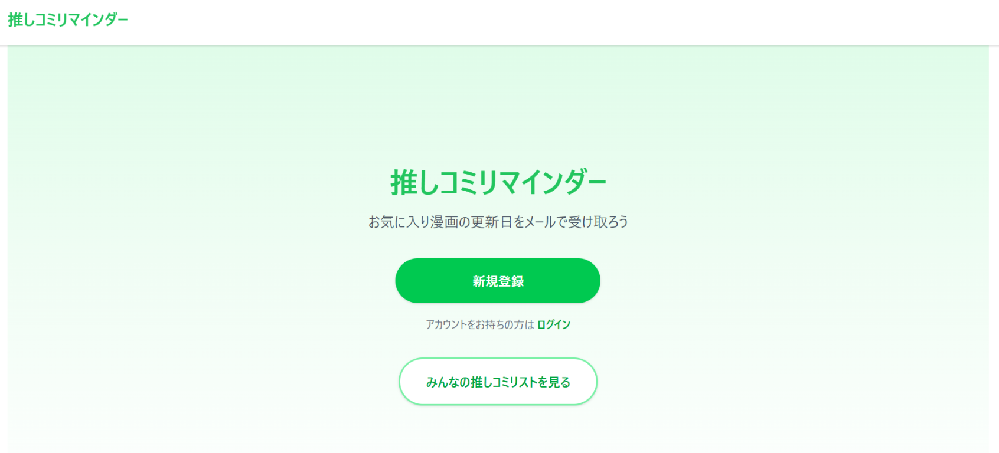
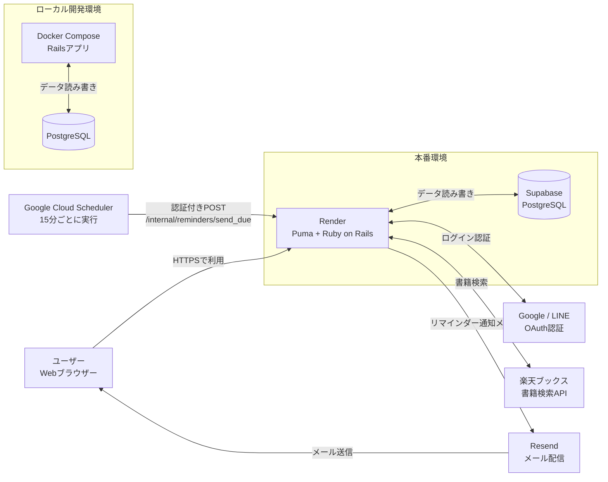
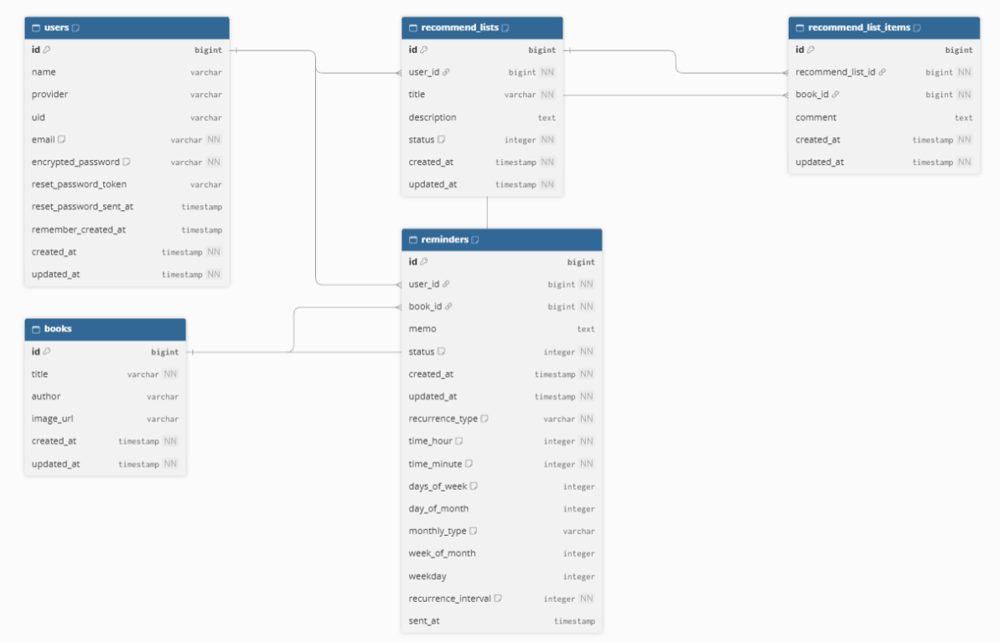

# 推しコミリマインダー

Web漫画の更新日をメールで受け取れる通知機能と、自身の購読リストをWeb上で公開・共有できる機能を備えたリマインド＆布教ができるWebアプリです。

---

## 開発のきっかけ

自身が複数のWebマンガを追う中で感じた「更新日の失念による読み逃しの落胆」をなくしたいという思いから開発しました。
単なる個人用のリマインダーにとどまらず、ファン同士で連載を追いかける熱量を「推しコミリスト」として共有・布教できるサービスを目指しています。

---

## 解決したい課題

### ターゲットユーザー
複数のWebマンガアプリや公式サイトで連載作品を平行して読んでいるユーザー。

### 課題と既存サービスの限界
- **更新日の失念**: 各アプリの更新日がバラバラで、無料公開期間（1週間など）を逃してしまう。
- **巡回の手間**: 更新確認のために複数のアプリやブラウザを開き直すのが煩わしい。
- **既存の限界**: マンガアプリの通知は宣伝が多くピンポイントの更新が届かない。ToDoアプリでは「作品の共有・布教」ができない。

### このアプリが提供する価値（差別化ポイント）
- **メールによる一括通知**: 登録した作品の更新日に自動でメールが届き、読み逃しや無駄な巡回を防止。
- **「推しコミリスト」の共有**: リマインダー登録をそのまま「購読リストの公開・布教」へと繋げ、ファン同士でリアルタイムの連載を追う楽しさを共有。

---

## サービスURL・イメージ

- サービスURL: https://oshicomi-reminder.com/
- 

---

## 主な機能

- マンガの更新日をメールでお知らせ
登録したスケジュールに合わせて、対象作品のリマインダーをメールで受け取れます。同じ時間帯の通知は、1通にまとめて届きます。通知先のメールアドレスはプロフィールで登録・変更できます。

- 作品ごとに通知スケジュールを設定
毎日・毎週・毎月の繰り返しに対応しています。曜日を複数選んだり、月の日付や「第何週の何曜日」も指定できます。リマインダーにメモを登録でき、作品ページのURL等を記載できます。

- 「推しコミリスト」を作成・共有
リマインダーに登録した作品をもとにリストを作り、タイトルや説明、一言コメントを付けられます。公開・下書きを選べて、公開リストは他のユーザーも閲覧できます。

- ユーザー登録
GoogleアカウントまたはLINEアカウントでのユーザー登録/ログイン に対応しています。

---

## 技術スタック

### バックエンド / フロントエンド
- **Ruby**: 3.3.11
- **Ruby on Rails**: 7.2.3.1
- **ERB**: Railsのテンプレートエンジン
- **Tailwind CSS**: `tailwindcss-rails`によるスタイリング
- **Hotwire (Turbo / Stimulus)**: 画面遷移・動的UI
- **Importmap**: JavaScriptの読み込み

### データベース
- **Supabase (PostgreSQL)**: 本番環境のデータベース
- **PostgreSQL**: Docker Composeを使ったローカル開発環境

### 認証
- **Devise**
- **OmniAuth**: Google / LINEアカウントでのログイン

### メール送信 / 外部API
- **Resend**: リマインダー通知メールの配信
- **楽天ブックス書籍検索API**: 作品検索、書影・著者情報の取得

### 定期実行 / 通知
- **Google Cloud Scheduler**: 15分ごと（JST）に、認証付きHTTPリクエストでアプリの通知エンドポイントを呼び出す
- **Railsアプリケーション**: 通知時刻を過ぎたリマインダーを確認し、該当する作品の通知メールをResend経由で送信する

### インフラ / 開発環境
- **Render**: 本番環境のWebアプリケーションのホスティング
- **Puma**: Render上でRailsアプリケーションを実行するWebサーバー
- **お名前.com**: 独自ドメイン（oshicomi-reminder.com）の取得
- **Docker / Docker Compose**: アプリケーションとPostgreSQLの開発環境

---

## システム構成図・ER図

### システム構成図

### ER図

---

## 技術的な工夫・こだわったポイント

- **作品登録の手間を軽減**：楽天ブックス書籍検索APIを利用したマンガ検索・タイトル入力機能を実装しました。作品情報を検索して登録できるため、ユーザーがタイトルを手入力する負担を減らしています。
- **安定したリマインダー運用**：Google Cloud Schedulerから定期的に通知処理を実行する構成にしました。アプリケーション内で常時スケジューラーを稼働させずに済み、インフラコストを抑えつつ継続的にリマインダーを運用できます。
- **運用を見据えた通知方式の選択**：当初はLINE通知を採用していましたが、無料プランのメッセージ送信数に上限があるため、利用者の増加を見据えてメール通知に切り替えました。現在はResendを利用してリマインダーをメールで配信しています。
- **スムーズなログイン体験**：GoogleアカウントとLINEアカウントによるSSOログインに対応し、アカウント作成やログインの手間を軽減しました。

---

## その他リンク

- 利用規約: https://oshicomi-reminder.com/terms
- プライバシーポリシー: https://oshicomi-reminder.com/privacy_policy